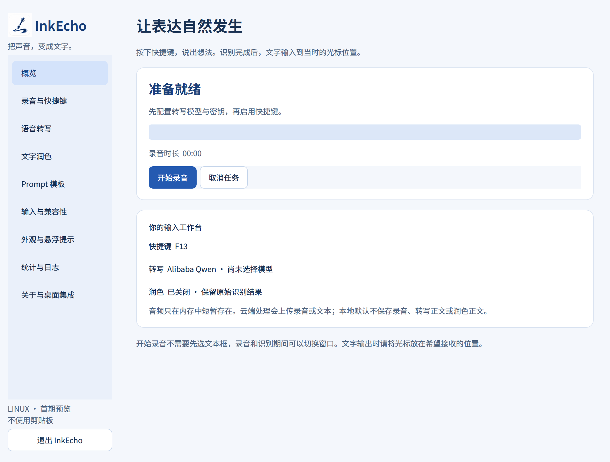

# InkEcho

InkEcho 是一个 Linux 桌面语音输入应用：录音后调用云端转写，可选按 Prompt 润色，再输入文字。不通过剪贴板或系统输入法接口提交文字。

当前已构建预览包为 **0.1.0a12**，R8 源码变更正在实施、尚未验收；本机稳定启动入口仍为已部署的 a9。本应用采用“输出到当前光标”的键盘输入方式：开始录音不要求先选文本框，录音、识别与润色期间可自由切换窗口；输出中切换窗口，后续字符也可进入新焦点。主动取消和过期任务仍停止未发送的文字，已经发送的按键无法撤回。

a10 源码加入 Qwen 实时转录协议接入、流式润色与边接收边输出、连接复用和分段计时，并修复 X11 分段字符失真、调整实测等待。实时转录须显式选择相应连接方式；不支持流式润色的网关可关闭流式开关。官方纯生成静音协议已实测；真实语音准确率与云端端到端性能仍待验，详见[性能优化验收总览](docs/performance-validation.md)。

a11 的固定整段场景曾通过，但其 R2 长流准确输出、取消正确后，新 GTK 窗口仍需 6.0944 秒就绪。这份负面结果保留为[历史 a11 记录](docs/performance-a11-package-validation.md)。

[R7 新源码](docs/ubuntu24-source-r7-validation.md)另行验证后，[实际 a12 包](docs/performance-a12-package-validation.md)在独立 Ubuntu 24.04.5 KVM Xorg 桌面通过首轮八种模式，包含四目标对照、取消、本地模拟服务、快速长流、首字不等待后续片段、切窗及提取后九页界面。单次快流清理后新 GTK/VTE 用 0.1747/0.3388 秒就绪，不代表任意流速或末字当刻响应。

随后 a12 R2 夹具为每片段配置 70 ms 等待，虽文字和取消正确，新 GTK 仍需 **5.8435 秒**就绪，延迟验收未通过。不能称 a12 已整体解决；R8 源码和新包待验，主机检查暂缓。见[a12 慢流反例](docs/performance-a12-paced-validation.md)。GNOME 46 原生 Wayland 输入、VM 麦克风、物理快捷键、FUSE 和安装集成等限制仍保留。

a9 新增 **GNOME 原生 Wayland 的实验性键盘输入路径**。本机 Ubuntu 26.04.1、GNOME/Mutter 50.1、Chrome 154 的独立测试窗口已接收完整的 26 字符中文、英文及符号样本，并恢复键盘映射和修饰键状态：源码验证了 textarea，实际 a9 AppImage 验证了 contenteditable。最终 a9 实际包还在同一输出任务中完成 contenteditable 的原生 Chrome → XWayland Chrome → 原生 Chrome 切换，26 字符全部进入对应窗口并恢复键盘状态。隔离 GNOME 环境另有 GTK 与 Chrome 证据；这些结果不代表所有 Wayland 应用或 Ubuntu 版本均已支持。详见[原生 Wayland 验证](docs/native-wayland-keymap-validation.md)。

原生 Wayland 路径目前只接受 BMP 文本（如上述中文、英文和符号）；emoji 等非 BMP 字符会明确拒绝。输出前须关闭 Caps Lock 并松开修饰键。现有 libpinyin 在没有预编辑文本时通过了本机样本测试，但其他输入法、已有候选或预编辑状态仍可能拦截按键，不能保证原样输出。

X11 / XWayland 路径保留；其历史录音、切窗、Unicode 和取消证据见[当前光标验收](docs/current-cursor-input-validation.md)、[键盘传输实测](docs/keyboard-transport-validation.md)及[a8 包验收](docs/focus-tracking-removal-release.md)。a8 的[焦点追踪清理审计](docs/focus-tracking-removal-audit.md)和此前 alpha6 的[原生 AT-SPI 验收](docs/native-voice-workflow-validation.md)、[独立云端验收](docs/native-cloud-workflow-validation.md)、[音频反馈修复](docs/audio-feedback-validation.md)保留为历史记录；旧版“失焦即取消”不再是当前操作要求。

**安装与下载状态：** 本机稳定启动入口已更新为最终 a9，Ctrl+F4 和三份用户配置保持不变，凭据继续由系统密钥服务管理。[GitHub v0.1 发布页](https://github.com/Creammmmm/InkEcho/releases/tag/v0.1)仍提供 a8，尚未更新为 a9。完整实测与部署证据见[当前验收报告](docs/native-wayland-parent-validation.md)。



截图来自 0.1.0a7 实际 AppImage，在 Ubuntu 26.04 GNOME Wayland 上以独立默认测试配置运行；图中的 F13 不代表用户当前快捷键设置。

## 运行

需要 Linux 图形桌面、音频服务，以及已解锁的系统 Secret Service（例如 GNOME Keyring）。原生 Wayland 路径目前仅验证上述 GNOME 环境，需要 Mutter 键盘映射接口、libei 和 libxkbcommon；X11 / XWayland 路径需要 libX11。云端功能需要自行配置对应供应商的有效密钥与模型。Ubuntu 24.04/26.04 的完整 Wayland/X11 桌面矩阵尚未全部实测。

源码运行需要 Python 3.12+ 和 uv：

```sh
uv sync --locked
uv run python -m inkecho
```

在界面中分别设置转录与润色服务，测试麦克风，选择 Prompt；GNOME 快捷键需要在录音设置页主动启用。其他桌面可自行将快捷键绑定到 `python -m inkecho --toggle`，使用实际安装的 Python 完整路径。开始后可切换窗口，识别完成时将光标放在希望接收文字的位置。主动取消会停止后续发送；目标不支持时会提示错误，不会自动粘贴。

独立本地 a12 预览包为 `dist/InkEcho-0.1.0a12-x86_64.AppImage`，Noble 首轮八种模式通过，但慢流 R2 暴露残余桌面延迟，整轮未完成、主机检查暂缓。**先从旧版托盘菜单正常退出，再启动 a12**；否则单实例通信可能只唤起仍在运行的 a9。此操作不替换原有 a9 稳定入口、自启动或公开 release：

```sh
chmod +x dist/InkEcho-0.1.0a12-x86_64.AppImage
./dist/InkEcho-0.1.0a12-x86_64.AppImage
```

a12 包的哈希与已完成范围见[a12 包记录](docs/performance-a12-package-validation.md)。[a11 包记录](docs/performance-a11-package-validation.md)与[a10 包报告](docs/performance-package-validation.md)保留各自版本的结果，不包含后续修复。通用构建步骤与运行依赖见[打包说明](docs/packaging.md)。桌面启动器、图标与自启动均由用户主动安装；移动 AppImage 后可在设置中修复路径。

## 验证与文档

```sh
uv run ruff check .
uv run ruff format --check .
uv run pytest -q
```

集成测试需要允许本地套接字。部分受限沙箱会禁止 asyncio 的线程唤醒套接字，造成线程测试等待；应在正常本地环境运行。

- [用户指南](docs/user-guide.md) · [故障排查](docs/troubleshooting.md)
- [兼容性矩阵](docs/compatibility-matrix.md) · [实际验收清单](docs/acceptance-checklist.md)
- [性能优化验收总览](docs/performance-validation.md)
- [架构](docs/architecture.md) · [供应商](docs/providers.md) · [配置与凭据](docs/configuration.md)
- [阶段 0 实测报告](docs/feasibility-report.md) · [开发与提交流程](docs/DEVELOPMENT.md)
- [项目规范](docs/PROJECT_SPEC.md) · [Agent 开发入口](AGENTS.md)

## 隐私与许可证

音频在内存中处理，默认不保存录音或识别正文。转录会把音频发送到所配置的云端服务；开启润色会进一步发送识别文字。API Key 只通过系统凭据服务保存，普通 JSON 与日志不保存密钥。统计只保存汇总数字，缺失 Token 用量明确显示未知。

项目采用 [MIT License](LICENSE)。随包第三方运行时的许可见[第三方声明](THIRD_PARTY_NOTICES.md)。Windows/macOS 仅预留适配接口，尚未支持。
