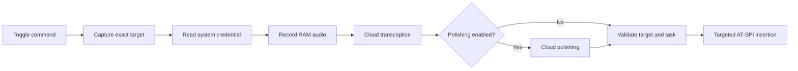

# Architecture

InkEcho is a user-session application, not a system input method. Linux adapters
are isolated from the task controller, configuration and provider protocols.
PySide6 and qasync share one event loop; asynchronous D-Bus and HTTP operations do
not require a second UI thread or a polling bridge.

## Task flow

`Session` in `app.py` coordinates adapters. `TaskController` in `core.py` owns a
unique task ID and permits only one active task. Every post-await result must still
belong to that task. Capture occurs before credential lookup so a slow keyring
cannot silently retarget a different window. Starting from the settings window
includes an explicit delay to let the user select a target before capture.

Focus generation, caret, target object and active window are checked by
`platform/accessibility.py`. Focus loss permanently invalidates the generation,
even if focus later returns. Cancellation suppresses provider results and pending
delivery. The adapter calls one target's `EditableText.InsertText`; it does not
simulate global keypresses, retry ambiguous delivery, or use a clipboard. A remote
application's already-accepted insertion cannot be retracted.

## Modules and boundaries

| Module | Responsibility |
|---|---|
| `__main__`, `app`, `ui/` | Lifecycle, same-user single-instance commands, orchestration and settings |
| `core` | Platform-independent states, task identity, cancellation and completion |
| `audio` | Qt input devices, PCM capture and RAM WAV encoding |
| `providers` | Separate Qwen transcription and OpenAI-compatible polishing/model protocols |
| `config`, `security` | Versioned separate JSON records and explicit Secret Service storage |
| `platform/accessibility` | Target capture, event invalidation and guarded Unicode delivery |
| `platform/hotkeys` | Explicit GNOME GSettings shortcut registration with conflict checks |
| `statistics`, `logging` | Numeric aggregates and bounded diagnostic codes without content |
| `integration` | User-owned desktop launcher, icons, path repair and opt-in autostart |

The UI calls provider abstractions rather than implementing vendor HTTP requests.
Audio and raw text are transient. Keys are read in a worker via `asyncio.to_thread`
and cleared from session references after a task; Python cannot promise physical
erasure of all immutable-string copies. Ordinary configuration stores references,
never credentials. Provider failures expose safe messages rather than raw response
bodies. TLS verification remains enabled.

## Desktop limitations

The production adapter currently runs only on X11 and only for controls exposing
the required editable accessibility interface. Native Wayland transport probes and
XTest laboratory scripts are not alternate production backends. GNOME shortcut
settings registration has been tested with exact restoration, but native physical
activation remains pending. Other desktops can configure an external shortcut to
the same `--toggle` command explicitly.

The text-free overlay requests no focus and no mouse input. A tray menu is used
where available; settings and separate stop/cancel controls remain available when
there is no tray. AppImage bundles Python/Qt and application dependencies but still
uses the host display, audio, accessibility and credential services.

See [acceptance checklist](acceptance-checklist.md) for evidence boundaries and
[compatibility matrix](compatibility-matrix.md) for untested environments.
