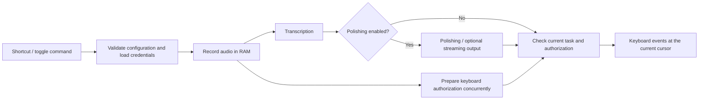

# Architecture

InkEcho is a user-session application, not a system input method. PySide6 and
qasync share one managed event loop. The task controller does not depend on a
particular desktop or provider; Linux keyboard transports and network protocols
remain behind adapters.

## Task flow

`Session` in `app.py` coordinates each operation. `TaskController` in `core.py`
owns one active task ID; the session also checks task epochs after asynchronous
boundaries. Recording starts before waiting for keyboard authorization. The first
valid PCM sample changes the overlay from starting to listening. HTTP recognition
uploads after recording stops; supported WebSocket protocols feed PCM during
recording. Qwen server-VAD drafts update an in-memory preview; final delivery waits
for recognition/session completion and the same task's keyboard authorization.
Optional streaming polishing overlaps confirmed text production and output.

Recording does not capture or validate an input target. The user may change focus
while recording, transcribing or polishing. Keyboard events go to the cursor that
has focus at delivery; a later character may enter a newly focused window. Focus
changes alone do not cancel a task. Explicit cancellation, expiry and replacement
stop unsent output, release held keys and restore owned mappings. Already emitted
input cannot be retracted; ambiguous delivery is never automatically replayed.
Clipboard output is never used. The default output router retains simulated
keyboard transport and may select an explicitly installed optional input-method
bridge after capability and identity checks; users can also select a method.
Unknown delivery is not replayed through another transport.

## Modules and boundaries

| Module | Responsibility |
| --- | --- |
| `__main__`, `runtime` | Single-instance lifecycle, lightweight control commands and managed Qt/asyncio loop |
| `app`, `core` | Recording/processing orchestration, task ownership, cancellation and final completion |
| `audio` | Qt input devices, PCM capture and transient RAM WAV encoding |
| `providers`, `http_asr`, `polish_protocols`, `polish_stream` | Model queries, HTTP transcription and polishing protocols |
| `asr_streaming`, realtime adapters | Allowlisted protocol selection, bounded WebSocket sessions and final-result barriers |
| `streaming_output` | Ordered incremental output tied to the active task |
| `platform/keyboard`, `hybrid_keyboard` | X11/XWayland events and output-time transport selection |
| `platform/wayland_keyboard`, `wayland_worker`, `wayland_keymap`, `eis` | GNOME native keyboard guardian, per-character acknowledgements and mapping recovery |
| `platform/hotkeys`, `capabilities` | Explicit GNOME shortcut registration, read-only health and actual environment detection |
| `config`, `security`, `provider_credentials` | Separate configuration records and config-root-bound credential JSON |
| `ui/` | Five-page workspace, tray/notifications and display-only recording overlays |
| `statistics`, `performance`, `logging` | Numeric aggregates, timing and bounded diagnostic codes without user content |
| `integration` | Explicit user-owned launcher/icon installation, path repair and opt-in autostart |

The workspace has Overview, Model Configuration, Polishing Styles, Settings and
Help. Settings centralizes processing preferences, audio/shortcut capture,
appearance, compatibility, data, logs and desktop integration. Model setup uses
local platform guidance and fixed links; opening it does not query credentials
or call a cloud API. Supported account-balance queries are separate bounded,
read-only operations; unavailable balances remain unknown.

GNOME Wayland selects `HybridKeyboardInput`: it checks the current output-time
window to choose XWayland events or the native GNOME route. The native guardian
is a separate process with bounded IPC, one current character per acknowledgement
and recovery on cancellation or EOF. Other sessions use the X11 keyboard adapter;
this is not a claim that every other desktop is supported. Transport failure does
not fall back to clipboard or replay uncertain input through another method.
The enclosing default router gives verified Fcitx priority, and optionally probes
the separately enabled GNOME-owned bridge. Missing or explicitly disabled optional
extensions retain legacy policy; damaged or uncertain installations fail closed
unless the verified Fcitx route itself succeeds. These checks are bounded evidence,
not universal target attribution or application-delivery acknowledgement.

The main settings window stays native Wayland. Its overlay uses an independent
XCB display host with non-activating window flags and bounded display-only IPC;
Xorg uses the local overlay widget. All three styles show state and available
live drafts. Drafts are replaceable RAM snapshots, not early keyboard output.
Closing settings normally hides to the tray; no-tray sessions retain a recoverable
window. Fully exiting stops the app; `--toggle` alone does not cold-start it.

## Configuration and privacy

A new configuration directory has no preselected cloud provider. Settings,
provider records and prompt records are separate JSON files. All authentication
fields live in that directory's plaintext `credentials.json`; provider records
hold references, and provider parameters reject embedded secrets. Credential
storage enforces directory 0700/file 0600, atomic writes and symlink rejection.
It does not read or migrate old system-keyring entries. Credential lookup runs
in a worker; task references are cleared afterward, but Python cannot guarantee
physical erasure of every immutable-string copy.

Audio, transcripts and drafts are transient. Ordinary diagnostic logs contain
fixed codes/numbers, not keys, raw cloud responses or user text. Provider adapters
preserve TLS verification and validate their endpoint/protocol/response bounds.
AppImage bundles Python, Qt and dependencies while using host display, audio and
GNOME services; it does not require host accessibility insertion or a keyring.

## Measured support

Current package acceptance covers Ubuntu 24.04 / GNOME 46 Xorg and Ubuntu 26.04 /
GNOME 50 native Wayland and XWayland, within the recorded test targets. GNOME 46
native Wayland is not supported. The native path retains its BMP Unicode limit;
unsupported non-BMP text is rejected. No Windows/macOS or arbitrary-app support
is inferred. Physical microphone, physical shortcuts and authenticated cloud
checks must be recorded separately from local/synthetic tests.

Every new AppImage requires the same version and SHA to pass actual-package
checks on both Ubuntu systems before distribution. See the [compatibility
matrix](compatibility-matrix.md), [acceptance checklist](acceptance-checklist.md)
and [0.6.0 package report](v0.6.0-release-validation.md) for evidence and limits.
