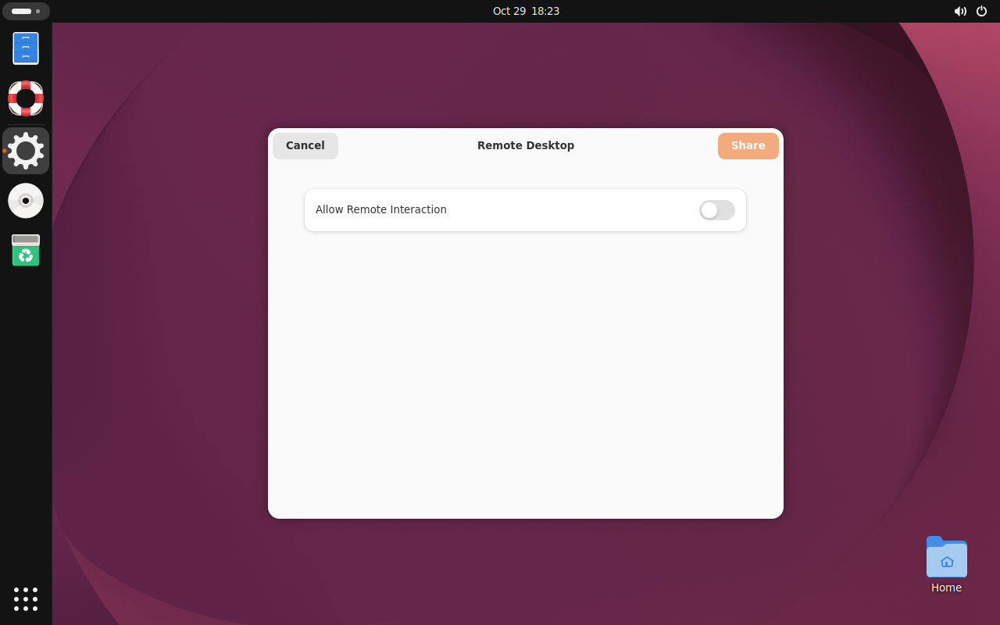

# Ubuntu 26 actual Pinyin guard follow-up — 2026-10-30

## Result and exact scope

PASS: Ubuntu 26.04.1 Wayland session, owned GTK3 XWayland Entry (GDK_BACKEND=x11), Fcitx5 5.1.19, official Resolute Pinyin 5.1.12-1 / LibIME 1.1.14-1, native addon SHA-256 acd896aae8ab38ecca2685c0dd8639f2910e841176eadccf59ee4943b158c4de. This is the identical native addon tested with real Pinyin on Ubuntu 24 X11. Runtime qualification SHA override remains explicitly test-only. No shared allowlist, product code, host desktop configuration, or provider credentials were changed.

Final actual26-qmp-r2: normal default-auto Fcitx output 甲乙; paired virtual-hardware a key control reached the owned Entry, with key press/release recorded. Real n/i created preedit length 2 while the committed baseline remained 甲乙a. A new candidate task attempting 戊 returned fcitx_composition_active with zero acknowledged attempts; committed text and preedit length remained exactly unchanged. Space then committed the original composition as 你, with preedit cleared. A later 己庚 task canceled after the first acknowledgement left only 己 after 1.2 seconds. The refused 戊 was not replayed when composition cleared. Actor and private daemon exited 0, exact prior user IM hints restored. See results.json and hardware-key-receipts.json.

Only the isolated VM's virtual keyboard was used to set up real Pinyin, through QMP send-key with an explicit 80ms hold time. These are virtual hardware events through the guest desktop, not direct GTK event injection or physical-human keys. Each test key was requested only while the actor reported its owned window active and Entry focused; no concurrent focus-changing test was run. Product text still used the unchanged real auto Fcitx addon route. No clipboard or artificial server preedit was used.

## Why the previous XTest setup was inconclusive

The prior experiment remains a real retained failure: XTest calls succeeded without observed receiver preedit, and the strict fixture stopped before any composition-body test. This follow-up first kept an XTest display connection alive, added XSync, monitored actual owned GTK key events, and tested plain a with keyboard-us. That control still produced no key event or committed text, and the owned window became inactive. It was again rejected before Pinyin or candidate body.

The isolated VM screenshot below directly showed an unapproved GNOME Remote Desktop permission dialog with Allow Remote Interaction disabled. Thus this XTest setup had encountered desktop input authorization, not established a usable key route. This explains the observed persistent-control failure; no claim is made that every earlier transient XTest request was individually diagnosed. The dialog was canceled with this VM's Escape key. No authorization was granted or denied on the user's host. QMP virtual-hardware keys then provided an independent positive control and real Pinyin sample without XTest.

Xwayland's XTest/libei integration is described in the [upstream libei README](https://chromium.googlesource.com/external/gitlab.freedesktop.org/libinput/libei/+/refs/heads/main). The screenshot and receiver-event records, rather than successful XTest return values, are the evidence for this guest's blocked control.

## Reproduction and evidence

The stopped Ubuntu 26 child from the preceding experiment already contained the exact official dependency packages and was fully SHA-verified while restoring it into a 512MiB container tmpfs. All original backing/base disks and that compressed snapshot were read-only. Guest writes stayed in RAM to avoid the user disk quota. wrapper.py validates the restored disk SHA, launches the recorded QEMU command, waits for normal shutdown, then archives and stream-verifies the complete final child before container exit.

Use the same candidate source/deps/private manifest structure from the prior experiment. boot.json records exact isolated mounts and QEMU wrapper entry; qemu.json records the original NIC/device ordering. run.py runs in the graphical guest using its real user bus and private candidate/config/data; actor.py owns the Entry and records only public fixture text/owned key events. hardware-run.py services that guest's request mailbox through qmp-key.py, never another desktop. The guest output share must be mounted at /mnt/inkecho-output. First cancel any prior fixture Remote Desktop request, then run the virtual-hardware fixture; engine selection, preedit, no-send guard and Chinese completion assertions are mandatory. These scripts depend on the private test VM fixture and are not a universal user-facing installer.

Raw guest record archive: /tmp/inkecho-fcitx-preedit-guard-20261030/pinyin26-followup/guest-desktop-records.tar.gz, 1,873,662 bytes, SHA-256 6a0f81e6447fed19f62cc5b5aace43045f5b04e28be49747a674dc6a49ece73d. Original failed XTest receipt, before/after fixture sources, screen PNG/PPM, complete host QMP receipts, and all older experiment evidence remain in the same task root. The final data does not replace the prior failed samples.

## Cleanup and limits

Normal guest poweroff, QEMU exit 0, wrapper/container wait 0, no OOM. RAM child was fully archived to 61,804,556 bytes, SHA-256 e1f41777de8e59fbe9792eb2ef4e8cfc3a3e7016bfa193563d91fa92936b3245; full decompression matched original disk SHA-256 af9c0e97a32182fb908d598593186f21c9ce889056daa7b4bac261557793be5b. Docker then reclaimed its tmpfs. No parent disk or original archive was deleted. Final user quota remaining 104,343,552 bytes.

Together with the Ubuntu 24 experiment this establishes real Pinyin protection for the same native addon in two bounded desktop configurations. It does not establish native Wayland GTK, other engines, browsers/Electron, hidden client-only composition state, or every session/backend combination. It is not same-AppImage dual-system acceptance: no new AppImage was built, deployed, or published, and formal staging qualification remains unchanged pending review.
